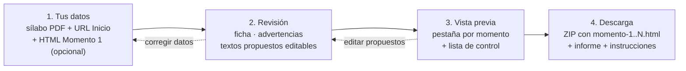
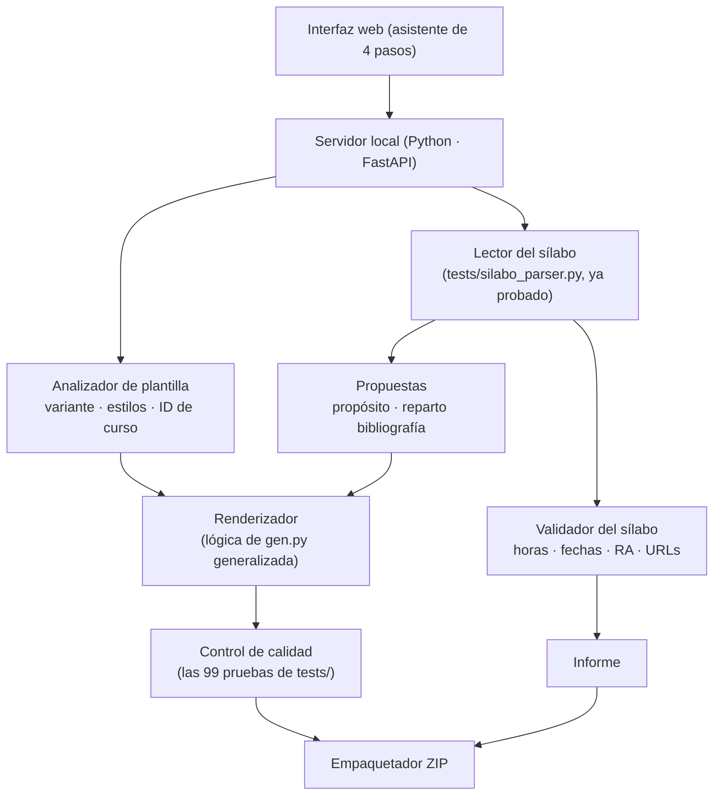

# Mapa del sistema · "Sílabo → Aula virtual" (propuesta para validar)

> ⚠️ **Versión 1 (histórica).** Desde el 06/11/2026 el sistema **sí publica en Canvas** con el token del
> docente (vista previa + confirmación + respaldo + verificación + restaurar) y ya no pide el HTML del
> Momento 1. Ver `sistema/README.md` para el diseño vigente.

> Estado: **diseño, sin código del sistema**. El prompt maestro (`PROMPT_MAESTRO_Silabo_a_Canvas.md`)
> **no se modifica**: el sistema implementa sus reglas en código, de forma determinista, y usa
> las pruebas de `tests/` como control de calidad antes de entregar.

## 1. Idea en una línea
El docente sube su sílabo y la URL de su curso; el sistema le muestra un informe para revisar,
le deja ajustar lo que el sílabo no trae y le entrega **una carpeta (ZIP) con un HTML por momento**,
listo para pegar en Canvas. **El sistema no se conecta a Canvas ni pide token.**

## 2. Flujo para el docente (4 pasos)



| Paso | Qué pide / muestra | Regla del prompt que aplica |
|---|---|---|
| **1. Tus datos** | (a) Sílabo PDF · (b) URL de la página Inicio de su curso · (c) HTML de su página "Momento 1" — opcional; si no lo pega, se usa la plantilla institucional. | ENTRADAS 1–3. Sin URL no se avanza (regla 7). |
| **2. Revisión** | Ficha del curso (asignatura, periodo, docente, **ID de curso detectado**, variante de plantilla), tabla por momento, **advertencias**, textos **PROPUESTOS** editables (propósitos y reparto de bibliografía complementaria), contenido sin lugar en la página (recursos, política IA). | FASE 1 del prompt; VALIDACIONES; "reportar, no corregir". |
| **3. Vista previa** | El HTML real de cada momento dentro de un marco blanco tipo Canvas + **lista de control ✔/✘** (las pruebas de `tests/`). Si algo falla, no se habilita la descarga. | FASE 2; lista de control; reglas de maquetación. |
| **4. Descarga** | ZIP `<periodo>_<asignatura>/` con los HTML, `informe.html` y `LEEME.txt` (cómo pegar en Canvas y respaldar la página anterior). | "Cómo cargar en Canvas". |

## 3. Componentes (arquitectura)



| Componente | Qué hace | Estado actual |
|---|---|---|
| Lector del sílabo | PDF → JSON (momentos, sesiones, horas, rúbricas, PIS, bibliografía). Une celdas cortadas entre páginas y URL partidas. | **Hecho y probado** (`tests/silabo_parser.py`). |
| Validador | Suma de horas = totales; fechas solapadas o fuera del periodo; RA citados existen; indicadores × 5 niveles; URL válidas. Produce **advertencias**, no corrige. | Reglas definidas en el prompt; falta empaquetarlas. |
| Analizador de plantilla | Del HTML del docente: bloques presentes (propósito, enlaces…), estilos, filas modelo. Si no hay HTML → plantilla institucional. Extrae `HOST`, `ID_CURSO`, `SLUG_INICIO` de la URL. | Por hacer. |
| Propuestas | **Propósito**: 1 oración en infinitivo a partir del título y la evidencia (regla fija; opcional: servidor IA de la UTI). **Bibliografía complementaria**: 2 por momento por afinidad de palabras clave con los contenidos. Todo editable en el paso 2. | Por hacer (hoy lo hice a mano). |
| Renderizador | Llena la plantilla con el parser HTML (nunca regex), clona N filas de sesión / K de rúbrica, estilos de fila intermedia/última, escapa texto, arma el botón Inicio con el ID del curso. | Lógica existe en `gen.py` (fija para este curso); hay que generalizarla. |
| Control de calidad | Corre las pruebas de `tests/` sobre los HTML generados antes de habilitar la descarga. | **Hecho** (99 pruebas, 12/12 mutaciones detectadas). |
| Empaquetador | ZIP con HTML + informe + LEEME. | Por hacer (simple). |

## 4. Entradas y salidas

**Entra (del docente):**
- `silabo.pdf` — formato institucional (I–VII).
- `URL Inicio` — p. ej. `https://indoamerica.instructure.com/courses/12345/pages/inicio`.
- `HTML Momento 1` (opcional) — copiado del editor `</>` de su curso.

**Sale (carpeta ZIP):**
```
B26_Programacion_Estructurada/
├── momento-1.html
├── momento-2.html
├── momento-3.html
├── momento-4.html
├── informe.html      ← ficha, advertencias, textos propuestos usados, lista de control
└── LEEME.txt         ← cómo pegar cada HTML en Canvas y respaldar la versión anterior
```

## 5. Reglas que el sistema hace cumplir (del prompt, sin cambiarlo)
1. Copia literal de todo lo que trae el sílabo; lo que no trae se marca PROPUESTO y el docente lo revisa.
2. Diseño de la plantilla intacto: solo cambian contenido, número de filas y enlaces del curso.
3. Columnas por significado (Autónomo y Práctico-exp. invertidas respecto del sílabo).
4. Inconsistencias del sílabo → advertencias visibles; nunca se corrigen solas.
5. "(Pegar enlace)" queda para el docente; no se inventan enlaces.
6. Ningún ID de curso fijo: todo sale de la URL del docente.
7. Sin la lista de control en verde no se entrega la carpeta.

## 6. Decisiones a validar
| # | Decisión | Propuesta |
|---|---|---|
| 1 | ¿Dónde corre? | Servidor web en la red de la UTI (un solo despliegue, los docentes entran por navegador). Alternativa: app local con `iniciar.ps1`. |
| 2 | ¿Usa IA? | **No por defecto**: el sílabo institucional se lee con reglas (más exacto y sin costo). IA opcional solo para redactar el propósito. |
| 3 | ¿Se conecta a Canvas? | **No** en esta versión (sin token, sin riesgo). El docente pega el HTML. Posible fase 2: publicar con aprobación. |
| 4 | ¿Se guarda algo? | No: el PDF y los HTML se procesan en memoria y se borran al descargar (el sílabo trae datos personales del docente). |
| 5 | Sílabo con otro formato | Se rechaza con un mensaje claro ("no reconozco la sección IV Momentos") en lugar de generar algo incompleto. |
